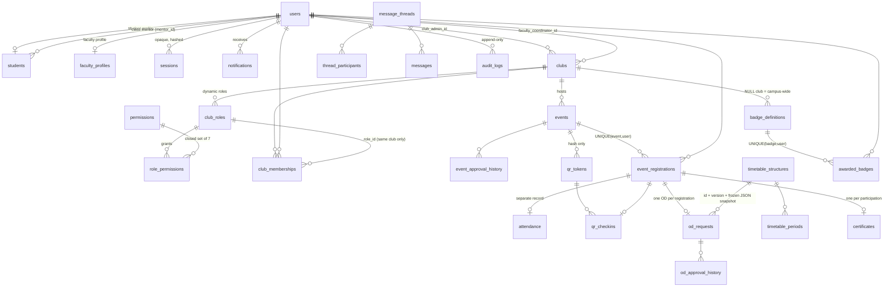
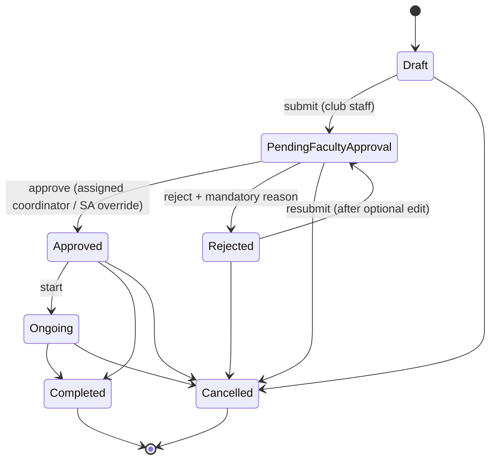
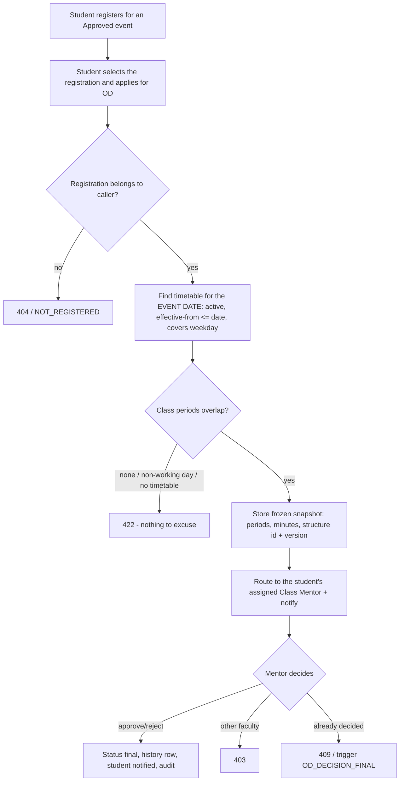
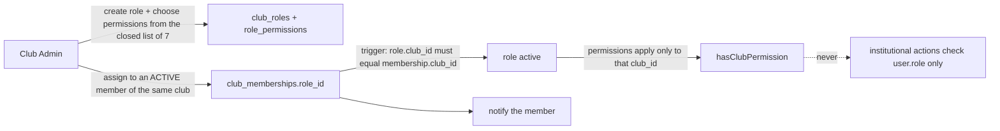
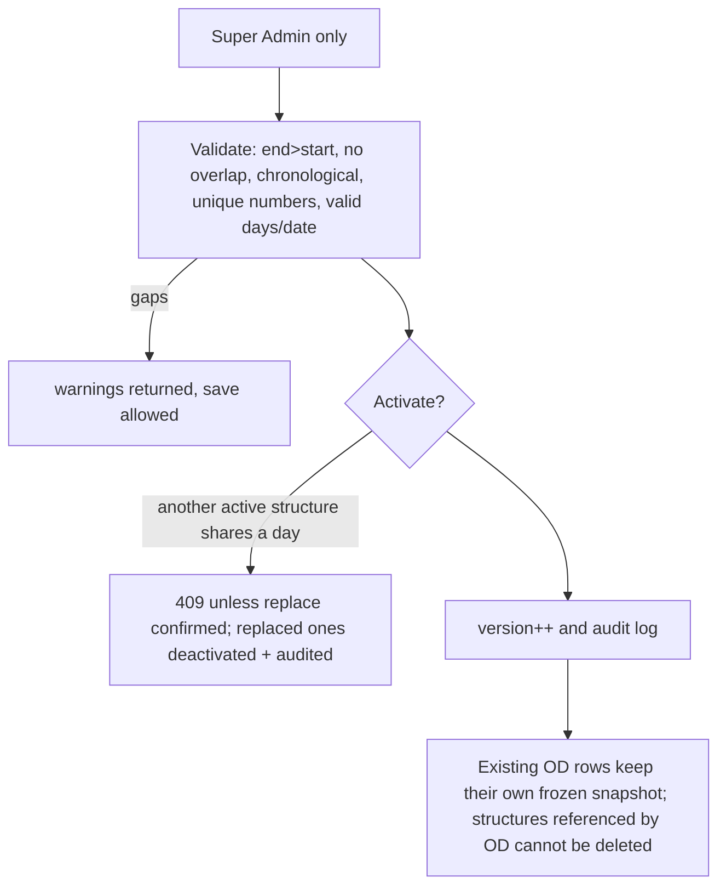
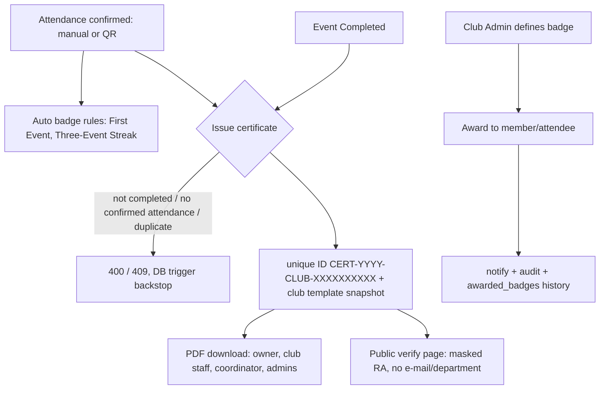

# Architecture

## Layers

```
Browser (React pages, Tailwind, Recharts)            src/app/**/page.tsx, src/components
   |  fetch + HttpOnly session cookie
Route handlers (thin)                                src/app/api/**/route.ts   -> route()/publicRoute() wrapper in src/lib/http.ts
   |  1. CSRF origin check  2. session lookup  3. Zod validation  4. call a service  5. map errors (HttpError / Zod / SQLite)
Services (business rules, transactions)              src/lib/services/*.ts     -> authorisation via src/lib/authz.ts
   |  Drizzle ORM (better-sqlite3, synchronous, BEGIN IMMEDIATE for contended writes)
SQLite (WAL, foreign_keys=ON)                        drizzle/0000_init.sql + 0001_triggers.sql
```

Design decisions worth defending:
* **Services own the rules, routes own transport.** Every service takes the `db` handle, so the same code runs in production, seeding and tests.
* **Notifications and audit rows are written inside the same transaction** as the operation they describe: they cannot exist for a failed operation (tested).
* **Registration is atomic**: `BEGIN IMMEDIATE` transaction (status check, window check, duplicate check, capacity count, insert) *plus* a UNIQUE index and a capacity trigger as a database-level backstop. `better-sqlite3` is synchronous, so writers are serialised; two independent connections racing for the last seat are also covered by a test.
* **Defence in depth in the database**: triggers make illegal states unrepresentable even if application code regresses (event transitions, capacity, OD snapshot immutability/final decisions, certificate prerequisites, role scope, append-only audit log).
* **Google identities are never auto-linked to existing password accounts**, because e-mail ownership is not verified at password registration.
* **Time**: event dates/times are naive local values interpreted in the server's time zone.

## ER diagram (SQLite, 27 tables)



Key constraints: `students.ra_number` UNIQUE + `CHECK(length=15 AND NOT GLOB '*[^A-Z0-9]*')`; `events` CHECKs for status, date/time format, `end>start`, capacity>0, reason-when-rejected; `timetable_periods` CHECK `end>start`, duration>0, UNIQUE(structure, number); `users.email` lower-case CHECK; every FK is `RESTRICT` for historical data (archive instead of delete), `CASCADE` only for pure child rows (sessions, role permissions, thread participants).

Triggers (`drizzle/0001_triggers.sql`): `trg_registration_guard`, `trg_event_transition`, `trg_od_snapshot_immutable`, `trg_od_decision_final`, `trg_certificate_guard`, `trg_students_roles`, `trg_membership_role_scope_ins/upd`, `trg_audit_no_update/delete`.

## Permission matrix

| Capability | Super Admin | Admin | Club Admin (own club) | Dynamic role (own club, per permission) | Faculty Coordinator (assigned) | Class Mentor (assigned) | Student |
|---|:-:|:-:|:-:|:-:|:-:|:-:|:-:|
| Create Admin / Faculty / Club Admin accounts | yes | Club Admin only | - | - | - | - | - |
| Activate / deactivate users | yes | not Admin/Super | - | - | - | - | - |
| Create / edit / archive clubs, assign staff | yes | yes | edit basics only | - | - | - | - |
| Timetable structures (create/edit/activate/delete) | **yes (only)** | no | no | no | no | no | no |
| Define club roles, assign roles | yes | yes | yes | no (`manage_members` may only remove/reinstate) | - | - | - |
| Create events / edit drafts | yes | yes | yes | `create_events` / `edit_events` | - | - | - |
| Submit event for approval | yes | yes | yes | `create_events` or `edit_events` | - | - | - |
| **Approve / reject event** | override only | no | no | no | **yes** | - | no |
| Start / complete / cancel event | yes | yes | yes | `edit_events` | - | - | - |
| Register for event | - | - | - | student only | - | - | yes (Approved, window open, seat free) |
| View registrations | yes | yes | yes | `manage_registrations` / `record_attendance` | yes | - | - |
| Record attendance, generate QR | yes | yes | yes | `record_attendance` | - | - | (QR check-in for self) |
| Issue certificates | yes | yes | yes | `issue_certificates` | oversight (view) | - | own only |
| Define badges / award badges | yes | yes | yes / yes | `award_badges` (award) | oversight (view) | - | - |
| Apply for OD | - | - | - | - | - | - | yes (needs registration) |
| **Approve / reject OD** | override only | no | no | no | no | **yes (assigned mentor only)** | no |
| Messages | - | - | yes (with faculty) | - | yes | yes | no |
| Audit log | yes | no | no | no | no | no | no |
| Portfolio | any student | any student | - | - | - | assigned mentees | own |

A faculty account can hold both responsibilities simultaneously (seed user `faculty@campus.edu`).

## Workflows

### Event lifecycle

Only *Approved* events accept registrations. Drafts, pending and rejected events are invisible to students. Every transition is enforced twice (service + DB trigger) and recorded in `event_approval_history`.

### OD workflow

Breaks (short/lunch) are reported as overlapping but never counted as missed academic periods. A partly overlapped class period counts with its full duration.

### Role management


### Timetable


### Certificates & badges


## API overview

Auth: `POST /api/auth/{login,register,logout,google}`, `GET /api/auth/{me,mentors}`, `PATCH /api/profile`
Users: `GET|POST /api/users`, `PATCH /api/users/:id`
Clubs: `GET|POST /api/clubs`, `GET|PATCH /api/clubs/:id`, `POST /api/clubs/:id/join`, `PATCH /api/clubs/:id/members`, `GET|POST|PATCH /api/clubs/:id/dynamic-roles`, `PUT /api/clubs/:id/certificate-template`
Events: `GET|POST /api/events`, `GET|PATCH /api/events/:id`, `POST /api/events/:id/{submit,approve,status,register,attendance}`, `GET /api/events/:id/{registrations,history}`
QR: `POST /api/qr/generate`, `POST /api/qr/verify-and-checkin`
Timetable: `GET /api/timetable`, `POST|PUT|PATCH|DELETE /api/timetable/manage`
OD: `GET /api/od`, `POST /api/od/{apply,calculate-overlap}`, `POST /api/od/:id/review`
Certificates: `GET|POST /api/certificates`, `POST /api/certificates/bulk-issue`, `GET /api/certificates/:id/pdf`, `GET /api/certificates/verify/:number` (public)
Badges: `GET|POST /api/badges`, `POST /api/badges/award`, `GET /api/badges/awarded`
Messaging: `GET /api/messages/contacts`, `GET|POST /api/messages/threads`, `GET|POST /api/messages/threads/:id`
Other: `GET|PATCH /api/notifications`, `GET /api/portfolio/:userId`, `POST /api/portfolio/{summary,pdf}`, `GET /api/analytics`, `GET /api/audit-logs`, `GET /api/health`

Errors are JSON `{ error, code }` with 400 (validation), 401, 403, 404, 409 (conflict/invalid transition), 422 (nothing to excuse), 429 (throttle).
